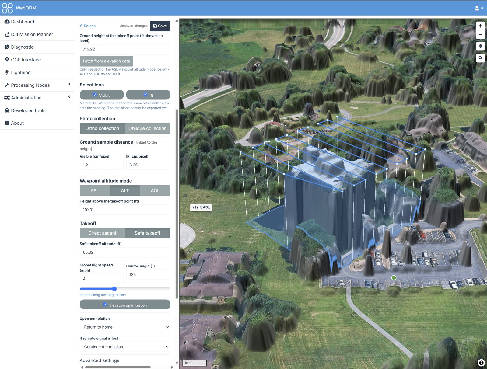

# DJI Mission Planner plugin for WebODM

**Draw your flight in 2D or 3D, fly it on your DJI drone: free mission planning, right inside WebODM.**

- **Map in 2D and 3D:** draw and edit routes on the map or in a 3D view that shows the trees and buildings from
  public USGS lidar (most of the US), with each waypoint's height above what is under it.
- **Accurate ground heights:** AGL routes follow a 10 m terrain from the lidar's highest points (COP30 elsewhere),
  converted to the heights DJI expects (WGS84, with GEOID18 and EGM96), and the route turns red wherever it would
  touch the ground, a tree or a roof.
- **Five kinds of route:** area surveys (ortho or oblique), linear corridors, waypoint and POI orbits, slopes and
  facades, and whole buildings, with the photo spacing worked out from your overlaps or ground sample distance.
- **Many DJI drones:** Matrice 4T/4E, Mavic 3 Enterprise, Matrice 30, 3D and 4D, M300/M350 with Zenmuse payloads,
  for DJI Pilot 2 and FlightHub 2; Mini, Air and Mavic consumer drones for DJI Fly.
- **Free and open:** no subscription and no paid map data; import and export Pilot 2 KMZ files and plain KML, and
  keep your routes on your own WebODM.

Plan survey flights for DJI drones in WebODM and download the mission file for DJI Pilot 2, or for DJI Fly on DJI's
consumer drones. Made for the Matrice 4T (thermal and visible light) and the Matrice 4E, whose files were checked
against Pilot 2's own.

**Drones** (chosen when a route is created; "Select Model" on the routes list):

| Drone | Cameras | Route types | AGL terrain follow |
|---|---|---|---|
| Matrice 4T, Mavic 3T | wide, thermal | all five | real-time or terrain model |
| Matrice 4E, Mavic 3E, Mavic 3M (RGB camera) | wide | all five | real-time or terrain model |
| Matrice 3TD | wide, thermal | all five | terrain model |
| Matrice 3D | wide | all five | terrain model |
| Matrice 30T, Matrice 4TD | wide, thermal | area, linear, waypoint | terrain model |
| Matrice 30, Matrice 4D | wide | area, linear, waypoint | terrain model |
| M300 RTK and M350 RTK with a Zenmuse H20T, H20N or H30T | wide, thermal | area, linear, waypoint | terrain model |
| M300 RTK and M350 RTK with a Zenmuse H20 or H30 | wide | area, linear, waypoint | terrain model |

DJI Fly drones (missions for the DJI Fly app):

| Drone | Route types | Heights |
|---|---|---|
| Mini 3 Pro, Mini 4 Pro, Mini 5 Pro, Air 3, Air 3S, Mavic 3 Classic, Mavic 4 Pro, Lito X1 | area (ortho), linear, waypoint | from the takeoff point; AGL as a height per point |

The M300 and M350 are chosen together with their payload (one entry per payload on the main gimbal). Their missions
name the wide camera `wide`, as DJI's specification lists their lenses, where the Matrice 4 series writes `visable`.

Only the Matrice 4T and 4E files have been checked against files from Pilot 2. The other drones' numbers come from
DJI's WPML specification, its product support list and spec pages (`mission_planner/drones.json` says where each
comes from); no file from their apps was at hand. Each drone is offered only the route types, and the real-time
terrain follow, that DJI's documents say it has.

**DJI Fly missions.** DJI publishes no format for DJI Fly; the planner writes what the open-source FlyPath found DJI
Fly reads (matched to a Mini 4 Pro mission from a DJI RC 2). Only the Mini 4 Pro's numbers are confirmed there; the
other drones' are FlyPath's best estimates, and DJI's Mini 3 Pro manual has no Waypoint Flight section at all. What a
DJI Fly mission does:
- An area (ortho only) or linear route is written as its waypoints, one per photo: DJI Fly ignores photos every so many
  meters. The first point turns the camera straight down and waits 3 s before its photo. Choose the main (wide)
  camera on the drone: the file names none.
- Heights are above the takeoff point. AGL becomes a height per point (the route's terrain, or a waypoint route's
  ground heights, against the ground at the takeoff point, or at the first point when none is set).
- Points are flown on gentle curves: DJI Fly reorders straight legs when it saves the mission again.
- A mission holds at most 200 points. A longer route downloads as a .zip of missions (`name_1_of_3.kmz` ...), each
  starting where the last ended; fly them in order, from the same takeoff point. A download holds at most 20 missions
  (3,981 points): a larger route is refused; split it, or fly higher.
- The takeoff security height, return height and takeoff speed are DJI Fly's own settings, not the planner's.

Putting a mission on the controller (DJI Fly lists only missions made in it):
1. In DJI Fly, make a placeholder waypoint mission (two or three points) and save it.
2. Connect the controller (DJI RC 2) to a computer by USB and open
   `Android/data/dji.go.v5/files/waypoint/`. The newest folder there is that mission's (a long name of letters and
   digits); it holds a `.kmz` of the same name.
3. Replace that `.kmz` with the downloaded one, renamed to the same name.
4. Unplug the controller, close DJI Fly and open it again; open the mission and check it before flying.

**Status:** version 2.0.0, the first published release (see `CHANGELOG.md`). The planner was moved here from LuxODM, a
fork of WebODM where it was written, and runs on an unmodified WebODM 4.0.0 or later.

**Experimental: use it at your own risk. Check every mission in DJI Pilot 2, FlightHub 2 or DJI Fly before flying it.**

## What it does

- **Routes**, kept per user, each with its own editor on a map with the instance's basemaps:
  - **Area**: draw an area; set the overlaps and the height (or the ground sample distance); nadir or oblique
    (Smart Oblique) photos.
  - **Linear**: a corridor along a line.
  - **Waypoint**: points clicked on the map (with "Add points"), the aircraft or camera turned toward a point of interest if wanted.
  - **Slope**: a steep face (an embankment, a dam, a quarry wall) mapped square-on in level lines.
  - **Geometric**: a building or other block mapped all round in level loops, its roof too.
- **Heights:** above the takeoff point, above sea level, or above the ground (the aircraft follows the terrain,
  embedded in the mission as Pilot 2's own exports do). Above sea level (ASL) needs the ground height at the takeoff
  point: picking ASL, or setting the takeoff point in ASL, fetches it from OpenTopography (one call), and a red hint
  under the takeoff point and the ASL button says what is missing or why the fetch failed. Slope and geometric routes
  can take their heights from the DSM of a task processed in WebODM.
- **Terrain for AGL routes:** a "Terrain" choice where the route flies over the terrain (the area editor's terrain
  model, and AGL waypoint routes): **Lidar surface (trees, roofs)**, the default, or **COP30**. The lidar terrain is
  the lidar surface's highest point in every 10 m (1/3 arc-second) cell, so trees and roofs are never underflown,
  moved from NAVD88 to the WGS84 ellipsoid with NOAA's GEOID18 grid (16.7 MB, downloaded once) and the NAD83(2011) to
  WGS84 step; cells without lidar are filled from COP30. Measured over a sample with trees and a building, it lay a median
  8 m above COP30 and Pilot 2's own terrain (up to about 35 m over trees). Where the lidar is not built yet, Fetch terrain builds it and
  waits (about 15 s a km²). COP30 is used instead, with the reason in the terrain status, outside the conterminous US,
  for routes over 4 km² with their 200 m margin, where there is no USGS lidar or its heights are not NAVD88 meters
  (each unit is checked against AWS's bare ground), or when a unit or the GEOID18 grid fails.
  The terrain travels inside the KMZ: load it in Pilot 2 on the controller. FlightHub 2 does not keep the terrain of
  any imported KMZ (its own exports included): it says "Altitude relative to ground error. Refresh file", and Update
  replaces the terrain with FlightHub 2's Global Elevation Data.
- **Pilot 2's missions can be imported** (a KMZ file), and every route is downloaded as a KMZ for Pilot 2.
- **KML:** "Import KMZ or KML file" also takes a plain KML, or a KMZ holding one (Google Earth, GIS tools, other
  planners): its first polygon becomes an area route, else its first line a linear route, else its points (two or
  more, in order) a waypoint route, for the model chosen in "Select Model". Heights in the file are not used. Each
  editor's **Download KML** saves the route's shape and its flight path (at the heights the 3D view draws it at:
  above sea level where known, else above the ground) for Google Earth and other apps; it is not a mission file.
- **3D view** (the layers button on the editor's map): the map tilted, the ground raised. Where USGS lidar covers
  the route (most of the US), the ground is a 1 m surface with its trees and buildings ("Lidar surface (US)", on by
  default), built when a route is opened (in 2D or 3D) from the public USGS 3DEP lidar on AWS by WebODM's worker, in the background
  (about 15 s and 100 MB of download a km², shown on the map while it builds), then kept for every route nearby
  (about 12 MB a km²; DJI Mission Planner page > Settings shows the size and clears it). It is kept under 5 GB: past that,
  the places opened longest ago are removed, and built again if a route there is opened. Elsewhere, or with it off, the
  shape of the ground from AWS Terrain Tiles. The mission's own terrain is unchanged.
- **Drawing and editing in 3D:** the editors' tools work in the 3D view as in 2D. A click lands on the surface under
  the pointer (a corner clicked on a roof is at the roof's position); the area stays laid on the surface. A waypoint's
  numbered marker, up at its point in the air, is dragged there: the point follows the pointer at its height (AGL
  points at their height above the surface), and heights are still typed in the point's panel. A point higher than
  the camera cannot be shown in the air: zoom out to see it.
- **The route in the air in 3D:** the path the aircraft flies is drawn at its height, with thin lines down to the
  surface from each point of a waypoint route and from the ends of each line of the others, so the clearance over
  the ground, trees and roofs can be seen. ALT routes are drawn above the takeoff point's ground (the 3D view's
  surface there until its height is set), ASL routes at their height, AGL routes over the terrain the aircraft follows
  (the route's terrain, once fetched; until then above the 3D view's surface), slope and building routes at their
  ellipsoidal heights. The routes' heights above sea level are EGM96, the lidar's NAVD88: they can differ by a meter
  or so in the US.
- **Collisions, in 2D and 3D:** where the route goes into the surface (the ground, trees or a roof), that part of its
  line is red, with 10 m of yellow before and after it, so each collision's start and end stand out: on the 2D map
  over the route's lines, in 3D drawn through the surface. The side panel says in how many places the route goes into
  the surface, or that it stays above it. The route is checked every 5 m against the finest surface there is (the
  lidar's 1 m surface where built, else the shape of the ground), the same in both views whatever the zoom; until the
  lidar surface is built (it starts when the route is opened), trees and roofs are not counted.
- **Waypoint height labels:** beside each numbered point of a waypoint route, in 2D and 3D, its height above the
  surface right under it (trees and roofs where the lidar surface is built), in the editor's units; red, with a
  negative height, when the point is below it.
- **Height under the pointer:** beside the pointer on the editor's map, in 2D and 3D, the height above sea level
  ("216.2 m ASL") of what is under it, in the editor's units: the top of trees and roofs where the lidar surface is
  built, else the shape of the ground. Over the route's line it adds the route's height above the surface there
  ("216.2 m ASL, route 38.0 m above"; red when the route is below it). The map's cursor is the arrow, so it is clear
  what is pointed at.
- **Pointer tool** (the editors' first tool, which every route opens in): a click on the map puts a dot there with
  its height above sea level ("216.2 m ASL", as the tooltip reads it); each next click adds another, joined to the one
  before by a dotted line labelled with the difference ("+12.3 m", the later minus the earlier), in the editor's units,
  in 2D and 3D. A click on a dot, or choosing another tool, clears them; they are not saved with the route. The area
  editor draws with Polygon, Rectangle or Line, the waypoint editor adds points with "Add points". Rectangle draws
  square to the screen, not to north: turn the map (right-drag) to line a rectangle up with a building or a field.

## Requirements

WebODM 4.0.0 or later. The editors' map (MapLibre 6) needs a browser with WebGL2 and ES2022: any
current Chrome, Edge, Firefox or Safari.

## Installing

Needs WebODM 4.0.0 or later.

1. Download `mission_planner-<version>.zip` from the repository's
   [Releases](https://github.com/WinuxNomacs/webodm-dji-mission-planner/releases) (or build it from a checkout with
   `dev/package.sh`).
2. In WebODM, as an administrator: Administration > Plugins, "Load Plugin (.zip)", and choose the zip. The plugin is
   enabled when installed, and "DJI Mission Planner" shows in the side menu.

**Upgrading:** Administration > Plugins, delete DJI Mission Planner, then load the new zip. The routes, their terrain and
the OpenTopography key stay: they are kept outside the plugin's folder.

**Terrain:** the ground heights and the COP30 terrain under a route come from [OpenTopography](https://opentopography.org/)
(Copernicus GLO-30 and SRTM GL1), which needs a free API key (the lidar terrain needs none, but fills its holes from COP30). An administrator sets it on the DJI Mission Planner page,
under Settings (the button shows to administrators only): saving tries the key with one OpenTopography request and
keeps it only if OpenTopography accepts it. The page never shows the key, only whether one is set and where from.
`WO_OPENTOPOGRAPHY_API_KEY` in the environment of WebODM's `webapp` container, when set, wins over the saved key.
Without a key the rest of the planner works; fetching terrain or a ground height says where to set one.

**Routes** are kept in WebODM's plugin data, per user, and the terrain under them in WebODM's media
(`plugins/mission_planner_data/terrain`), beside the plugin's folder: deleting the plugin leaves both.

**Routes from LuxODM:** LuxODM's mission planner was this plugin's start. Its routes come over in two steps: in
LuxODM, `python manage.py export_routes <file>` (in its `webapp` container) writes them all to one JSON file; then an
administrator imports that file on the DJI Mission Planner page > Settings page, under "Import routes from LuxODM". Each
route goes to the account with its LuxODM owner's username, with its settings, terrain and times, and gets a new id;
a route whose owner has no account here is skipped, and the page lists each route with where it went. Importing a
file again imports its routes again, as copies.

## Developing

`CLAUDE.md` describes the dev environment (`dev/webodm.sh`: WebODM 4.0.0 with the plugin mounted) and
the checks. The aircraft, their mission-file numbers and cameras are in `mission_planner/drones.json`.

## Licence

AGPL-3.0, as WebODM.
